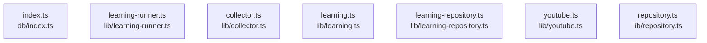

# dependency-map

[解析トップへ戻る](../README.md)

内容確認したソースの静的依存関係。PythonはAST、JavaScript／TypeScriptはimport文の字句抽出です。型だけのimport、再export、コメントや動的importの扱いには制限があり、ランタイム依存の完全なグラフではありません。

## 要素の説明

### n-db-index-ts-e11670

確認済みファイル: `db/index.ts`

解析: 字句抽出。静的なimport／export参照です。関数の実行順序やHTTP通信は表していません。

宣言: `database`

- `cloudflare:workers` → 外部・標準ライブラリ・別名など。ローカル対応先は未確定

[詳細な図と説明を見る](n-db-index-ts-e11670/README.md)

### n-lib-collector-ts-9a882c

確認済みファイル: `lib/collector.ts`

解析: 字句抽出。静的なimport／export参照です。関数の実行順序やHTTP通信は表していません。

宣言: `collect`, `save`

- `./growth` → `lib/growth.ts`（内容確認済み）
- `./repository` → `lib/repository.ts`（内容確認済み）
- `./youtube` → `lib/youtube.ts`（内容確認済み）

[詳細な図と説明を見る](n-lib-collector-ts-9a882c/README.md)

### n-lib-learning-repository-ts-7eb455

確認済みファイル: `lib/learning-repository.ts`

解析: 字句抽出。静的なimport／export参照です。関数の実行順序やHTTP通信は表していません。

宣言: `LearningRepository`

- `./repository` → `lib/repository.ts`（内容確認済み）
- `./learning` → `lib/learning.ts`（内容確認済み）

[詳細な図と説明を見る](n-lib-learning-repository-ts-7eb455/README.md)

### n-lib-learning-runner-ts-81beae

確認済みファイル: `lib/learning-runner.ts`

解析: 字句抽出。静的なimport／export参照です。関数の実行順序やHTTP通信は表していません。

宣言: `ScopedRepository`, `runLearning`

- `./collector` → `lib/collector.ts`（内容確認済み）
- `./growth` → `lib/growth.ts`（内容確認済み）
- `./learning` → `lib/learning.ts`（内容確認済み）
- `./learning-repository` → `lib/learning-repository.ts`（内容確認済み）
- `./youtube` → `lib/youtube.ts`（内容確認済み）
- `./repository` → `lib/repository.ts`（内容確認済み）

[詳細な図と説明を見る](n-lib-learning-runner-ts-81beae/README.md)

### n-lib-learning-ts-b10db4

確認済みファイル: `lib/learning.ts`

解析: 字句抽出。静的なimport／export参照です。関数の実行順序やHTTP通信は表していません。

宣言: `canonical`, `digest`, `observationIds`, `evidenceKey`, `makeLearningDraft`, `diagnoseExperiment`, `productionPackage`

- `./growth` → `lib/growth.ts`（内容確認済み）

[詳細な図と説明を見る](n-lib-learning-ts-b10db4/README.md)

### n-lib-repository-ts-6ea79c

確認済みファイル: `lib/repository.ts`

解析: 字句抽出。静的なimport／export参照です。関数の実行順序やHTTP通信は表していません。

宣言: `Repository`

- `@/db` → 外部・標準ライブラリ・別名など。ローカル対応先は未確定
- `./growth` → `lib/growth.ts`（内容確認済み）

[詳細な図と説明を見る](n-lib-repository-ts-6ea79c/README.md)

### n-lib-youtube-ts-bd1f51

確認済みファイル: `lib/youtube.ts`

解析: 字句抽出。静的なimport／export参照です。関数の実行順序やHTTP通信は表していません。

宣言: `YouTubeError`, `counter`, `durationSeconds`, `pacificDay`, `addDays`, `YouTubeClient`

- `./growth` → `lib/growth.ts`（内容確認済み）

[詳細な図と説明を見る](n-lib-youtube-ts-bd1f51/README.md)

