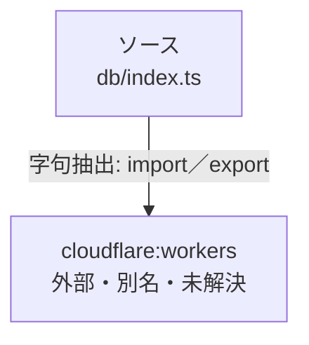

# dependency-map/n-db-index-ts-e11670

[解析トップへ戻る](../../README.md)

確認済みファイル: `db/index.ts`

解析: 字句抽出。静的なimport／export参照です。関数の実行順序やHTTP通信は表していません。

宣言: `database`

- `cloudflare:workers` → 外部・標準ライブラリ・別名など。ローカル対応先は未確定

## 要素の説明

### n-cloudflare-workers-a6cf65

参照名: `cloudflare:workers`

ローカルのソース対応先を確定できませんでした。外部ライブラリ、標準ライブラリ、型別名などを区別する追加確認が必要です。

### source

`db/index.ts` の内容を確認しました。

