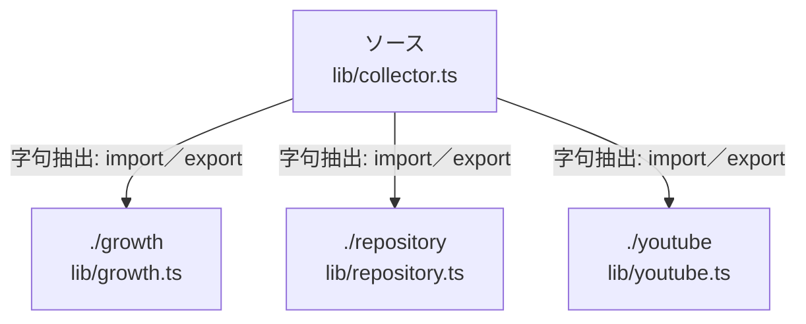

# dependency-map/n-lib-collector-ts-9a882c

[解析トップへ戻る](../../README.md)

確認済みファイル: `lib/collector.ts`

解析: 字句抽出。静的なimport／export参照です。関数の実行順序やHTTP通信は表していません。

宣言: `collect`, `save`

- `./growth` → `lib/growth.ts`（内容確認済み）
- `./repository` → `lib/repository.ts`（内容確認済み）
- `./youtube` → `lib/youtube.ts`（内容確認済み）

## 要素の説明

### n-growth-f9c6bf

参照名: `./growth`

対応する実在ソース: `lib/growth.ts`。内容確認済み。

### n-repository-eafc79

参照名: `./repository`

対応する実在ソース: `lib/repository.ts`。内容確認済み。

### n-youtube-9d1e57

参照名: `./youtube`

対応する実在ソース: `lib/youtube.ts`。内容確認済み。

### source

`lib/collector.ts` の内容を確認しました。

