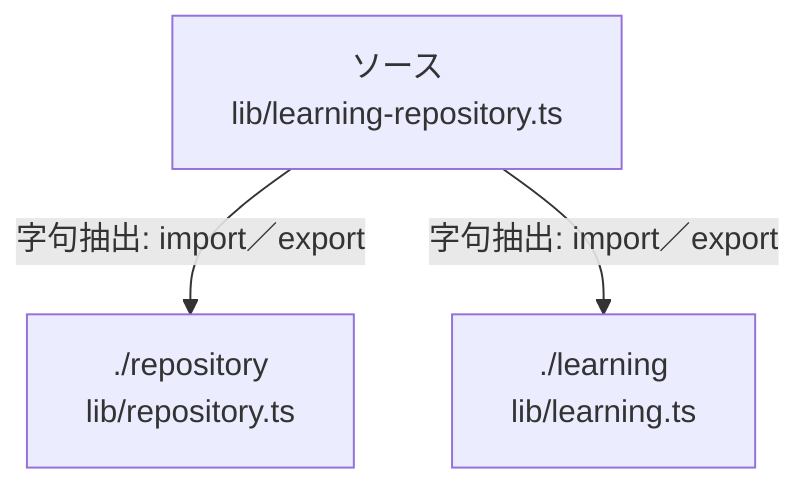

# dependency-map/n-lib-learning-repository-ts-7eb455

[解析トップへ戻る](../../README.md)

確認済みファイル: `lib/learning-repository.ts`

解析: 字句抽出。静的なimport／export参照です。関数の実行順序やHTTP通信は表していません。

宣言: `LearningRepository`

- `./repository` → `lib/repository.ts`（内容確認済み）
- `./learning` → `lib/learning.ts`（内容確認済み）

## 要素の説明

### n-learning-62dc7f

参照名: `./learning`

対応する実在ソース: `lib/learning.ts`。内容確認済み。

### n-repository-eafc79

参照名: `./repository`

対応する実在ソース: `lib/repository.ts`。内容確認済み。

### source

`lib/learning-repository.ts` の内容を確認しました。

