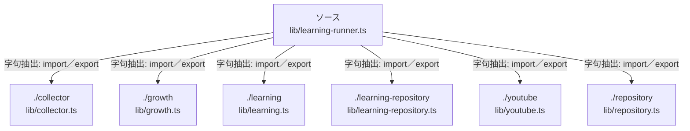

# dependency-map/n-lib-learning-runner-ts-81beae

[解析トップへ戻る](../../README.md)

確認済みファイル: `lib/learning-runner.ts`

解析: 字句抽出。静的なimport／export参照です。関数の実行順序やHTTP通信は表していません。

宣言: `ScopedRepository`, `runLearning`

- `./collector` → `lib/collector.ts`（内容確認済み）
- `./growth` → `lib/growth.ts`（内容確認済み）
- `./learning` → `lib/learning.ts`（内容確認済み）
- `./learning-repository` → `lib/learning-repository.ts`（内容確認済み）
- `./youtube` → `lib/youtube.ts`（内容確認済み）
- `./repository` → `lib/repository.ts`（内容確認済み）

## 要素の説明

### n-collector-5b1c93

参照名: `./collector`

対応する実在ソース: `lib/collector.ts`。内容確認済み。

### n-growth-f9c6bf

参照名: `./growth`

対応する実在ソース: `lib/growth.ts`。内容確認済み。

### n-learning-62dc7f

参照名: `./learning`

対応する実在ソース: `lib/learning.ts`。内容確認済み。

### n-learning-repository-731b9f

参照名: `./learning-repository`

対応する実在ソース: `lib/learning-repository.ts`。内容確認済み。

### n-repository-eafc79

参照名: `./repository`

対応する実在ソース: `lib/repository.ts`。内容確認済み。

### n-youtube-9d1e57

参照名: `./youtube`

対応する実在ソース: `lib/youtube.ts`。内容確認済み。

### source

`lib/learning-runner.ts` の内容を確認しました。

