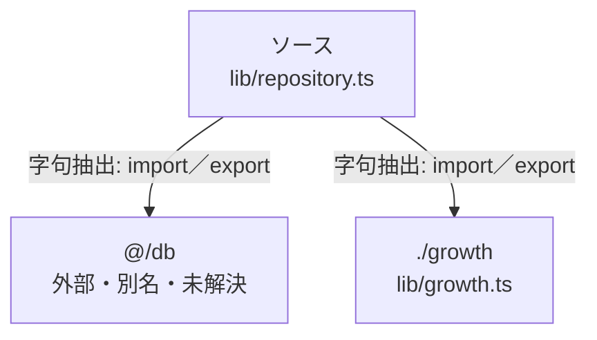

# dependency-map/n-lib-repository-ts-6ea79c

[解析トップへ戻る](../../README.md)

確認済みファイル: `lib/repository.ts`

解析: 字句抽出。静的なimport／export参照です。関数の実行順序やHTTP通信は表していません。

宣言: `Repository`

- `@/db` → 外部・標準ライブラリ・別名など。ローカル対応先は未確定
- `./growth` → `lib/growth.ts`（内容確認済み）

## 要素の説明

### n-db-39346a

参照名: `@/db`

ローカルのソース対応先を確定できませんでした。外部ライブラリ、標準ライブラリ、型別名などを区別する追加確認が必要です。

### n-growth-f9c6bf

参照名: `./growth`

対応する実在ソース: `lib/growth.ts`。内容確認済み。

### source

`lib/repository.ts` の内容を確認しました。

