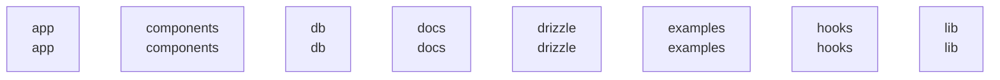

# overall-architecture/group-1

[解析トップへ戻る](../../README.md)

このグループは表示用の区切りです。独立した実行モジュールではありません。

## 要素の説明

### n-app-7d1043

確認したパス: `app`。配下の登録ファイルは22件。

- `app/api/collect/route.ts`（一覧のみ）
- `app/api/drafts/[id]/route.ts`（一覧のみ）
- `app/api/drafts/route.ts`（一覧のみ）
- `app/api/experiments/route.ts`（一覧のみ）
- `app/api/learning/route.ts`（一覧のみ）
- `app/api/production-worker/artifact/route.ts`（一覧のみ）
- `app/api/production-worker/route.ts`（一覧のみ）
- `app/api/production/[id]/video/route.ts`（一覧のみ）
- `app/api/production/route.ts`（一覧のみ）
- `app/api/state/route.ts`（一覧のみ）
- `app/api/videos/route.ts`（一覧のみ）
- `app/chatgpt-auth.ts`（一覧のみ）
- `app/globals.css`（一覧のみ）
- `app/layout.tsx`（一覧のみ）
- `app/page.tsx`（一覧のみ）
- `app/production/page.tsx`（一覧のみ）
- `app/production/production.css`（一覧のみ）
- `app/production/production.tsx`（一覧のみ）
- `app/studio.tsx`（一覧のみ）
- `app/workflow/page.tsx`（一覧のみ）
- `app/workflow/workflow.css`（一覧のみ）
- `app/workflow/workflow.tsx`（一覧のみ）

[詳細な図と説明を見る](n-app-7d1043/README.md)

### n-components-c212f0

確認したパス: `components`。配下の登録ファイルは61件。

- `components/ui/accordion.tsx`（一覧のみ）
- `components/ui/alert-dialog.tsx`（一覧のみ）
- `components/ui/alert.tsx`（一覧のみ）
- `components/ui/aspect-ratio.tsx`（一覧のみ）
- `components/ui/attachment.tsx`（一覧のみ）
- `components/ui/avatar.tsx`（一覧のみ）
- `components/ui/badge.tsx`（一覧のみ）
- `components/ui/breadcrumb.tsx`（一覧のみ）
- `components/ui/bubble.tsx`（一覧のみ）
- `components/ui/button-group.tsx`（一覧のみ）
- `components/ui/button.tsx`（一覧のみ）
- `components/ui/calendar.tsx`（一覧のみ）
- `components/ui/card.tsx`（一覧のみ）
- `components/ui/carousel.tsx`（一覧のみ）
- `components/ui/chart.tsx`（一覧のみ）
- `components/ui/checkbox.tsx`（一覧のみ）
- `components/ui/collapsible.tsx`（一覧のみ）
- `components/ui/combobox.tsx`（一覧のみ）
- `components/ui/command.tsx`（一覧のみ）
- `components/ui/context-menu.tsx`（一覧のみ）
- `components/ui/dialog.tsx`（一覧のみ）
- `components/ui/direction.tsx`（一覧のみ）
- `components/ui/drawer.tsx`（一覧のみ）
- `components/ui/dropdown-menu.tsx`（一覧のみ）
- `components/ui/empty.tsx`（一覧のみ）
- `components/ui/field.tsx`（一覧のみ）
- `components/ui/form.tsx`（一覧のみ）
- `components/ui/hover-card.tsx`（一覧のみ）
- `components/ui/input-group.tsx`（一覧のみ）
- `components/ui/input-otp.tsx`（一覧のみ）
- `components/ui/input.tsx`（一覧のみ）
- `components/ui/item.tsx`（一覧のみ）
- `components/ui/kbd.tsx`（一覧のみ）
- `components/ui/label.tsx`（一覧のみ）
- `components/ui/marker.tsx`（一覧のみ）

### n-db-0352a8

確認したパス: `db`。配下の登録ファイルは2件。

- `db/index.ts`（内容確認済み）
- `db/schema.ts`（一覧のみ）

[詳細な図と説明を見る](n-db-0352a8/README.md)

### n-docs-71ab8b

確認したパス: `docs`。配下の登録ファイルは5件。

- `docs/GOAL.ja.md`（一覧のみ）
- `docs/LEARNING_LOOP.ja.md`（一覧のみ）
- `docs/PILOT_24.ja.md`（一覧のみ）
- `docs/PRODUCTION_BRIDGE.ja.md`（一覧のみ）
- `docs/ROADMAP.ja.md`（一覧のみ）

### n-drizzle-e5b43d

確認したパス: `drizzle`。配下の登録ファイルは5件。

- `drizzle/0000_kind_speed_demon.sql`（一覧のみ）
- `drizzle/0001_learning_loop.sql`（一覧のみ）
- `drizzle/0002_production_bridge.sql`（一覧のみ）
- `drizzle/meta/0000_snapshot.json`（一覧のみ）
- `drizzle/meta/_journal.json`（一覧のみ）

### n-examples-99345c

確認したパス: `examples`。配下の登録ファイルは2件。

- `examples/d1/app/api/notes/route.ts`（一覧のみ）
- `examples/d1/db/schema.ts`（一覧のみ）

### n-hooks-7e6ba5

確認したパス: `hooks`。配下の登録ファイルは1件。

- `hooks/use-mobile.ts`（一覧のみ）

### n-lib-9d062b

確認したパス: `lib`。配下の登録ファイルは16件。

- `lib/collector.ts`（内容確認済み）
- `lib/config.ts`（一覧のみ）
- `lib/demo.ts`（一覧のみ）
- `lib/growth.ts`（内容確認済み）
- `lib/http.ts`（一覧のみ）
- `lib/learning-repository.ts`（内容確認済み）
- `lib/learning-runner.ts`（内容確認済み）
- `lib/learning.ts`（内容確認済み）
- `lib/production/domain.ts`（一覧のみ）
- `lib/production/environment.ts`（一覧のみ）
- `lib/production/repository.ts`（一覧のみ）
- `lib/production/service.ts`（一覧のみ）
- `lib/repository.ts`（内容確認済み）
- `lib/utils.ts`（一覧のみ）
- `lib/validation.ts`（一覧のみ）
- `lib/youtube.ts`（内容確認済み）

[詳細な図と説明を見る](n-lib-9d062b/README.md)

