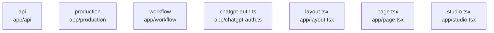

# overall-architecture/group-1/n-app-7d1043

[解析トップへ戻る](../../../README.md)

確認したパス: `app`。配下の登録ファイルは22件。

- `app/api/collect/route.ts`（一覧のみ）
- `app/api/drafts/[id]/route.ts`（一覧のみ）
- `app/api/drafts/route.ts`（一覧のみ）
- `app/api/experiments/route.ts`（一覧のみ）
- `app/api/learning/route.ts`（一覧のみ）
- `app/api/production-worker/artifact/route.ts`（一覧のみ）
- `app/api/production-worker/route.ts`（一覧のみ）
- `app/api/production/[id]/video/route.ts`（一覧のみ）
- `app/api/production/route.ts`（一覧のみ）
- `app/api/state/route.ts`（一覧のみ）
- `app/api/videos/route.ts`（一覧のみ）
- `app/chatgpt-auth.ts`（一覧のみ）
- `app/globals.css`（一覧のみ）
- `app/layout.tsx`（一覧のみ）
- `app/page.tsx`（一覧のみ）
- `app/production/page.tsx`（一覧のみ）
- `app/production/production.css`（一覧のみ）
- `app/production/production.tsx`（一覧のみ）
- `app/studio.tsx`（一覧のみ）
- `app/workflow/page.tsx`（一覧のみ）
- `app/workflow/workflow.css`（一覧のみ）
- `app/workflow/workflow.tsx`（一覧のみ）

## 要素の説明

### n-app-api-10c38b

実在パス: `app/api`。11ファイル。

- `app/api/collect/route.ts`
- `app/api/drafts/[id]/route.ts`
- `app/api/drafts/route.ts`
- `app/api/experiments/route.ts`
- `app/api/learning/route.ts`
- `app/api/production-worker/artifact/route.ts`
- `app/api/production-worker/route.ts`
- `app/api/production/[id]/video/route.ts`
- `app/api/production/route.ts`
- `app/api/state/route.ts`
- `app/api/videos/route.ts`

### n-app-chatgpt-auth-ts-e68ab9

実在パス: `app/chatgpt-auth.ts`。1ファイル。

- `app/chatgpt-auth.ts`

### n-app-layout-tsx-ee80c9

実在パス: `app/layout.tsx`。1ファイル。

- `app/layout.tsx`

### n-app-page-tsx-6f76c4

実在パス: `app/page.tsx`。1ファイル。

- `app/page.tsx`

### n-app-production-f2e4bd

実在パス: `app/production`。3ファイル。

- `app/production/page.tsx`
- `app/production/production.css`
- `app/production/production.tsx`

### n-app-studio-tsx-daf576

実在パス: `app/studio.tsx`。1ファイル。

- `app/studio.tsx`

### n-app-workflow-6f8177

実在パス: `app/workflow`。3ファイル。

- `app/workflow/page.tsx`
- `app/workflow/workflow.css`
- `app/workflow/workflow.tsx`

