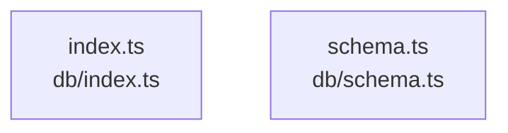

# overall-architecture/group-1/n-db-0352a8

[解析トップへ戻る](../../../README.md)

確認したパス: `db`。配下の登録ファイルは2件。

- `db/index.ts`（内容確認済み）
- `db/schema.ts`（一覧のみ）

## 要素の説明

### n-db-index-ts-e11670

実在パス: `db/index.ts`。1ファイル。

- `db/index.ts`

### n-db-schema-ts-88c732

実在パス: `db/schema.ts`。1ファイル。

- `db/schema.ts`

