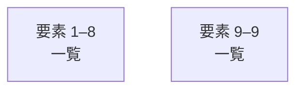

# overall-architecture/group-1/n-lib-9d062b

[解析トップへ戻る](../../../README.md)

確認したパス: `lib`。配下の登録ファイルは16件。

- `lib/collector.ts`（内容確認済み）
- `lib/config.ts`（一覧のみ）
- `lib/demo.ts`（一覧のみ）
- `lib/growth.ts`（内容確認済み）
- `lib/http.ts`（一覧のみ）
- `lib/learning-repository.ts`（内容確認済み）
- `lib/learning-runner.ts`（内容確認済み）
- `lib/learning.ts`（内容確認済み）
- `lib/production/domain.ts`（一覧のみ）
- `lib/production/environment.ts`（一覧のみ）
- `lib/production/repository.ts`（一覧のみ）
- `lib/production/service.ts`（一覧のみ）
- `lib/repository.ts`（内容確認済み）
- `lib/utils.ts`（一覧のみ）
- `lib/validation.ts`（一覧のみ）
- `lib/youtube.ts`（内容確認済み）

## 要素の説明

### group-1

このグループは表示用の区切りです。独立した実行モジュールではありません。

[詳細な図と説明を見る](group-1/README.md)

### group-2

このグループは表示用の区切りです。独立した実行モジュールではありません。

[詳細な図と説明を見る](group-2/README.md)

