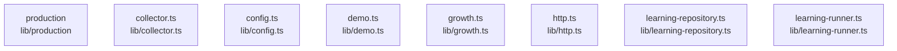

# overall-architecture/group-1/n-lib-9d062b/group-1

[解析トップへ戻る](../../../../README.md)

このグループは表示用の区切りです。独立した実行モジュールではありません。

## 要素の説明

### n-lib-collector-ts-9a882c

実在パス: `lib/collector.ts`。1ファイル。

- `lib/collector.ts`

### n-lib-config-ts-a948e6

実在パス: `lib/config.ts`。1ファイル。

- `lib/config.ts`

### n-lib-demo-ts-f74269

実在パス: `lib/demo.ts`。1ファイル。

- `lib/demo.ts`

### n-lib-growth-ts-f59d2a

実在パス: `lib/growth.ts`。1ファイル。

- `lib/growth.ts`

### n-lib-http-ts-eb15f8

実在パス: `lib/http.ts`。1ファイル。

- `lib/http.ts`

### n-lib-learning-repository-ts-7eb455

実在パス: `lib/learning-repository.ts`。1ファイル。

- `lib/learning-repository.ts`

### n-lib-learning-runner-ts-81beae

実在パス: `lib/learning-runner.ts`。1ファイル。

- `lib/learning-runner.ts`

### n-lib-production-20aa62

実在パス: `lib/production`。4ファイル。

- `lib/production/domain.ts`
- `lib/production/environment.ts`
- `lib/production/repository.ts`
- `lib/production/service.ts`

