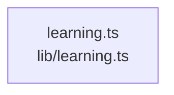

# overall-architecture/group-1/n-lib-9d062b/group-2

[解析トップへ戻る](../../../../README.md)

このグループは表示用の区切りです。独立した実行モジュールではありません。

## 要素の説明

### n-lib-learning-ts-b10db4

実在パス: `lib/learning.ts`。1ファイル。

- `lib/learning.ts`

