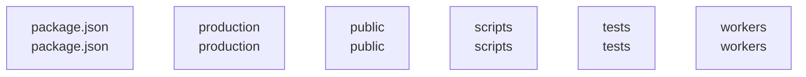

# overall-architecture/group-2

[解析トップへ戻る](../../README.md)

このグループは表示用の区切りです。独立した実行モジュールではありません。

## 要素の説明

### n-package-json-7030d0

確認したパス: `package.json`。配下の登録ファイルは1件。

- `package.json`（内容確認済み）

### n-production-90a883

確認したパス: `production`。配下の登録ファイルは87件。

- `production/MONITORING.ja.md`（一覧のみ）
- `production/README.md`（一覧のみ）
- `production/analysis/adaptation-2026-09-14.md`（一覧のみ）
- `production/analysis/color-game-prototype.json`（一覧のみ）
- `production/analysis/competitor-benchmarks-2026-09-14.json`（一覧のみ）
- `production/analysis/competitor-study-2026-09-14.md`（一覧のみ）
- `production/analysis/distribution-study-2026-09-14.md`（一覧のみ）
- `production/analysis/high-view-discovery-study-2026-09-14.json`（一覧のみ）
- `production/analysis/high-view-discovery-study-2026-09-14.md`（一覧のみ）
- `production/analysis/improvement-2026-09-13.md`（一覧のみ）
- `production/analysis/initial3-24h-status-2026-09-14.md`（一覧のみ）
- `production/analysis/new-three-production-2026-09-15.md`（一覧のみ）
- `production/analysis/poco-05-shape-game-review-2026-09-14.json`（一覧のみ）
- `production/analysis/promotion-public-evidence-2026-09-14.md`（一覧のみ）
- `production/analysis/promotion-simulation-2026-09-14.json`（一覧のみ）
- `production/analysis/promotion-simulation-2026-09-14.md`（一覧のみ）
- `production/analysis/shape-game-24h-2026-09-15.md`（一覧のみ）
- `production/analysis/shorter-intro-prototype.json`（一覧のみ）
- `production/analysis/topic-validation-plan-2026-09-14.md`（一覧のみ）
- `production/analysis/video-quality-audit-2026-09-14.json`（一覧のみ）
- `production/analysis/video-quality-audit-2026-09-14.md`（一覧のみ）
- `production/assets/poco-01-colors.png`（一覧のみ）
- `production/assets/poco-02-scarf.png`（一覧のみ）
- `production/assets/poco-03-rain.png`（一覧のみ）
- `production/assets/poco-channel-avatar.png`（一覧のみ）
- `production/assets/poco-color-game-sprites-v1.png`（一覧のみ）
- `production/assets/poco-hide-atlas-v1.png`（一覧のみ）
- `production/assets/poco-red-ball-atlas-v1.png`（一覧のみ）
- `production/assets/poco-shape-game-atlas-v2.png`（一覧のみ）
- `production/assets/thumbnails/poco-01-colors-v1.png`（一覧のみ）
- `production/assets/thumbnails/poco-02-scarf-v1.png`（一覧のみ）
- `production/assets/thumbnails/poco-03-rain-v1.png`（一覧のみ）
- `production/assets/thumbnails/poco-04-color-game-v1.png`（一覧のみ）
- `production/assets/thumbnails/poco-04-color-game-v2.png`（一覧のみ）
- `production/changes/channel-distribution-2026-09-14.json`（一覧のみ）

[詳細な図と説明を見る](n-production-90a883/README.md)

### n-public-61c9b2

確認したパス: `public`。配下の登録ファイルは1件。

- `public/favicon.svg`（一覧のみ）

### n-scripts-16728d

確認したパス: `scripts`。配下の登録ファイルは12件。

- `scripts/collector.mjs`（一覧のみ）
- `scripts/create_hide_atlas.py`（一覧のみ）
- `scripts/create_new_atlases.py`（一覧のみ）
- `scripts/install-ci.mjs`（一覧のみ）
- `scripts/migrate.mjs`（一覧のみ）
- `scripts/produce_color_game.py`（一覧のみ）
- `scripts/produce_video.py`（一覧のみ）
- `scripts/production-worker.mjs`（一覧のみ）
- `scripts/simulate_promotion.py`（一覧のみ）
- `scripts/sites-env.mjs`（一覧のみ）
- `scripts/test.mjs`（一覧のみ）
- `scripts/youtube-authorize.mjs`（一覧のみ）

[詳細な図と説明を見る](n-scripts-16728d/README.md)

### n-tests-04d13f

確認したパス: `tests`。配下の登録ファイルは11件。

- `tests/collector.test.ts`（一覧のみ）
- `tests/growth.test.ts`（一覧のみ）
- `tests/learning-repository.test.ts`（一覧のみ）
- `tests/learning.test.ts`（一覧のみ）
- `tests/production-domain.test.ts`（一覧のみ）
- `tests/production-repository.test.ts`（一覧のみ）
- `tests/production/conftest.py`（一覧のみ）
- `tests/production/test_runtime.py`（一覧のみ）
- `tests/production/test_upload.py`（一覧のみ）
- `tests/storage.test.ts`（一覧のみ）
- `tests/youtube.test.ts`（一覧のみ）

[詳細な図と説明を見る](n-tests-04d13f/README.md)

### n-workers-f74e09

確認したパス: `workers`。配下の登録ファイルは6件。

- `workers/learning-collector.ts`（一覧のみ）
- `workers/production/__init__.py`（一覧のみ）
- `workers/production/requirements.txt`（一覧のみ）
- `workers/production/runtime.py`（一覧のみ）
- `workers/production/upload.py`（一覧のみ）
- `workers/production/worker.py`（一覧のみ）

[詳細な図と説明を見る](n-workers-f74e09/README.md)

