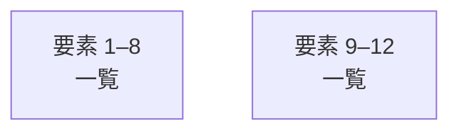

# overall-architecture/group-2/n-production-90a883

[解析トップへ戻る](../../../README.md)

確認したパス: `production`。配下の登録ファイルは87件。

- `production/MONITORING.ja.md`（一覧のみ）
- `production/README.md`（一覧のみ）
- `production/analysis/adaptation-2026-09-14.md`（一覧のみ）
- `production/analysis/color-game-prototype.json`（一覧のみ）
- `production/analysis/competitor-benchmarks-2026-09-14.json`（一覧のみ）
- `production/analysis/competitor-study-2026-09-14.md`（一覧のみ）
- `production/analysis/distribution-study-2026-09-14.md`（一覧のみ）
- `production/analysis/high-view-discovery-study-2026-09-14.json`（一覧のみ）
- `production/analysis/high-view-discovery-study-2026-09-14.md`（一覧のみ）
- `production/analysis/improvement-2026-09-13.md`（一覧のみ）
- `production/analysis/initial3-24h-status-2026-09-14.md`（一覧のみ）
- `production/analysis/new-three-production-2026-09-15.md`（一覧のみ）
- `production/analysis/poco-05-shape-game-review-2026-09-14.json`（一覧のみ）
- `production/analysis/promotion-public-evidence-2026-09-14.md`（一覧のみ）
- `production/analysis/promotion-simulation-2026-09-14.json`（一覧のみ）
- `production/analysis/promotion-simulation-2026-09-14.md`（一覧のみ）
- `production/analysis/shape-game-24h-2026-09-15.md`（一覧のみ）
- `production/analysis/shorter-intro-prototype.json`（一覧のみ）
- `production/analysis/topic-validation-plan-2026-09-14.md`（一覧のみ）
- `production/analysis/video-quality-audit-2026-09-14.json`（一覧のみ）
- `production/analysis/video-quality-audit-2026-09-14.md`（一覧のみ）
- `production/assets/poco-01-colors.png`（一覧のみ）
- `production/assets/poco-02-scarf.png`（一覧のみ）
- `production/assets/poco-03-rain.png`（一覧のみ）
- `production/assets/poco-channel-avatar.png`（一覧のみ）
- `production/assets/poco-color-game-sprites-v1.png`（一覧のみ）
- `production/assets/poco-hide-atlas-v1.png`（一覧のみ）
- `production/assets/poco-red-ball-atlas-v1.png`（一覧のみ）
- `production/assets/poco-shape-game-atlas-v2.png`（一覧のみ）
- `production/assets/thumbnails/poco-01-colors-v1.png`（一覧のみ）
- `production/assets/thumbnails/poco-02-scarf-v1.png`（一覧のみ）
- `production/assets/thumbnails/poco-03-rain-v1.png`（一覧のみ）
- `production/assets/thumbnails/poco-04-color-game-v1.png`（一覧のみ）
- `production/assets/thumbnails/poco-04-color-game-v2.png`（一覧のみ）
- `production/changes/channel-distribution-2026-09-14.json`（一覧のみ）

## 要素の説明

### group-1

このグループは表示用の区切りです。独立した実行モジュールではありません。

[詳細な図と説明を見る](group-1/README.md)

### group-2

このグループは表示用の区切りです。独立した実行モジュールではありません。

[詳細な図と説明を見る](group-2/README.md)

