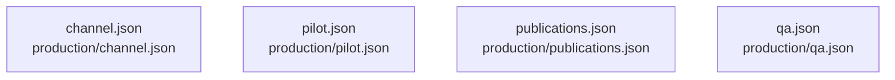

# overall-architecture/group-2/n-production-90a883/group-2

[解析トップへ戻る](../../../../README.md)

このグループは表示用の区切りです。独立した実行モジュールではありません。

## 要素の説明

### n-production-channel-json-2f7e37

実在パス: `production/channel.json`。1ファイル。

- `production/channel.json`

### n-production-pilot-json-18210f

実在パス: `production/pilot.json`。1ファイル。

- `production/pilot.json`

### n-production-publications-json-b35332

実在パス: `production/publications.json`。1ファイル。

- `production/publications.json`

### n-production-qa-json-b8ab2e

実在パス: `production/qa.json`。1ファイル。

- `production/qa.json`

