# overall-architecture/group-2/n-scripts-16728d

[解析トップへ戻る](../../../README.md)

確認したパス: `scripts`。配下の登録ファイルは12件。

- `scripts/collector.mjs`（一覧のみ）
- `scripts/create_hide_atlas.py`（一覧のみ）
- `scripts/create_new_atlases.py`（一覧のみ）
- `scripts/install-ci.mjs`（一覧のみ）
- `scripts/migrate.mjs`（一覧のみ）
- `scripts/produce_color_game.py`（一覧のみ）
- `scripts/produce_video.py`（一覧のみ）
- `scripts/production-worker.mjs`（一覧のみ）
- `scripts/simulate_promotion.py`（一覧のみ）
- `scripts/sites-env.mjs`（一覧のみ）
- `scripts/test.mjs`（一覧のみ）
- `scripts/youtube-authorize.mjs`（一覧のみ）

```mermaid
graph TD
    n-scripts-collector-mjs-514b0d["collector.mjs\nscripts/collector.mjs"]
    n-scripts-create-hide-atlas-py-1449db["create_hide_atlas.py\nscripts/create_hide_atlas.py"]
    n-scripts-create-new-atlases-py-2a6569["create_new_atlases.py\nscripts/create_new_atlases.py"]
    n-scripts-install-ci-mjs-ed5f4b["install-ci.mjs\nscripts/install-ci.mjs"]
    n-scripts-migrate-mjs-81b88e["migrate.mjs\nscripts/migrate.mjs"]
    n-scripts-produce-color-game-py-73abe3["produce_color_game.py\nscripts/produce_color_game.py"]
    n-scripts-produce-video-py-3572a1["produce_video.py\nscripts/produce_video.py"]
    n-scripts-production-worker-mjs-ad09a2["production-worker.mjs\nscripts/production-worker.mjs"]
```

## 要素の説明

### n-scripts-collector-mjs-514b0d

実在パス: `scripts/collector.mjs`。1ファイル。

- `scripts/collector.mjs`

### n-scripts-create-hide-atlas-py-1449db

実在パス: `scripts/create_hide_atlas.py`。1ファイル。

- `scripts/create_hide_atlas.py`

### n-scripts-create-new-atlases-py-2a6569

実在パス: `scripts/create_new_atlases.py`。1ファイル。

- `scripts/create_new_atlases.py`

### n-scripts-install-ci-mjs-ed5f4b

実在パス: `scripts/install-ci.mjs`。1ファイル。

- `scripts/install-ci.mjs`

### n-scripts-migrate-mjs-81b88e

実在パス: `scripts/migrate.mjs`。1ファイル。

- `scripts/migrate.mjs`

### n-scripts-produce-color-game-py-73abe3

実在パス: `scripts/produce_color_game.py`。1ファイル。

- `scripts/produce_color_game.py`

### n-scripts-produce-video-py-3572a1

実在パス: `scripts/produce_video.py`。1ファイル。

- `scripts/produce_video.py`

### n-scripts-production-worker-mjs-ad09a2

実在パス: `scripts/production-worker.mjs`。1ファイル。

- `scripts/production-worker.mjs`

