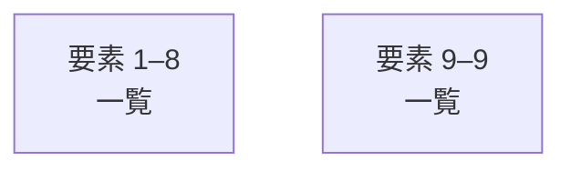

# overall-architecture/group-2/n-tests-04d13f

[解析トップへ戻る](../../../README.md)

確認したパス: `tests`。配下の登録ファイルは11件。

- `tests/collector.test.ts`（一覧のみ）
- `tests/growth.test.ts`（一覧のみ）
- `tests/learning-repository.test.ts`（一覧のみ）
- `tests/learning.test.ts`（一覧のみ）
- `tests/production-domain.test.ts`（一覧のみ）
- `tests/production-repository.test.ts`（一覧のみ）
- `tests/production/conftest.py`（一覧のみ）
- `tests/production/test_runtime.py`（一覧のみ）
- `tests/production/test_upload.py`（一覧のみ）
- `tests/storage.test.ts`（一覧のみ）
- `tests/youtube.test.ts`（一覧のみ）

## 要素の説明

### group-1

このグループは表示用の区切りです。独立した実行モジュールではありません。

[詳細な図と説明を見る](group-1/README.md)

### group-2

このグループは表示用の区切りです。独立した実行モジュールではありません。

[詳細な図と説明を見る](group-2/README.md)

