# overall-architecture/group-2/n-tests-04d13f/group-1

[解析トップへ戻る](../../../../README.md)

このグループは表示用の区切りです。独立した実行モジュールではありません。

```mermaid
graph TD
    n-tests-production-d281a9["production\ntests/production"]
    n-tests-collector-test-ts-db2297["collector.test.ts\ntests/collector.test.ts"]
    n-tests-growth-test-ts-4a5d81["growth.test.ts\ntests/growth.test.ts"]
    n-tests-learning-repository-test-ts-790b25["learning-repository.test.ts\ntests/learning-repository.test.ts"]
    n-tests-learning-test-ts-f7bdb9["learning.test.ts\ntests/learning.test.ts"]
    n-tests-production-domain-test-ts-eb839c["production-domain.test.ts\ntests/production-domain.test.ts"]
    n-tests-production-repository-test-ts-ac344e["production-repository.test.ts\ntests/production-repository.test.ts"]
    n-tests-storage-test-ts-008b23["storage.test.ts\ntests/storage.test.ts"]
```

## 要素の説明

### n-tests-collector-test-ts-db2297

実在パス: `tests/collector.test.ts`。1ファイル。

- `tests/collector.test.ts`

### n-tests-growth-test-ts-4a5d81

実在パス: `tests/growth.test.ts`。1ファイル。

- `tests/growth.test.ts`

### n-tests-learning-repository-test-ts-790b25

実在パス: `tests/learning-repository.test.ts`。1ファイル。

- `tests/learning-repository.test.ts`

### n-tests-learning-test-ts-f7bdb9

実在パス: `tests/learning.test.ts`。1ファイル。

- `tests/learning.test.ts`

### n-tests-production-d281a9

実在パス: `tests/production`。3ファイル。

- `tests/production/conftest.py`
- `tests/production/test_runtime.py`
- `tests/production/test_upload.py`

### n-tests-production-domain-test-ts-eb839c

実在パス: `tests/production-domain.test.ts`。1ファイル。

- `tests/production-domain.test.ts`

### n-tests-production-repository-test-ts-ac344e

実在パス: `tests/production-repository.test.ts`。1ファイル。

- `tests/production-repository.test.ts`

### n-tests-storage-test-ts-008b23

実在パス: `tests/storage.test.ts`。1ファイル。

- `tests/storage.test.ts`

