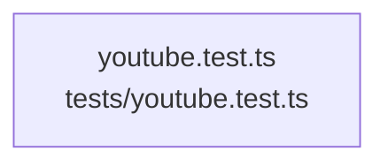

# overall-architecture/group-2/n-tests-04d13f/group-2

[解析トップへ戻る](../../../../README.md)

このグループは表示用の区切りです。独立した実行モジュールではありません。

## 要素の説明

### n-tests-youtube-test-ts-fc1a71

実在パス: `tests/youtube.test.ts`。1ファイル。

- `tests/youtube.test.ts`

