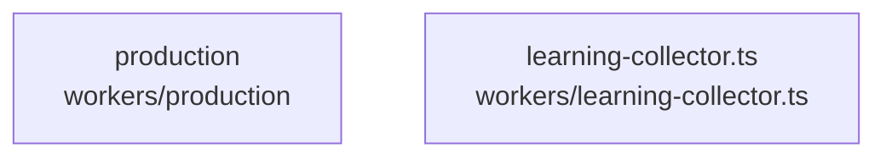

# overall-architecture/group-2/n-workers-f74e09

[解析トップへ戻る](../../../README.md)

確認したパス: `workers`。配下の登録ファイルは6件。

- `workers/learning-collector.ts`（一覧のみ）
- `workers/production/__init__.py`（一覧のみ）
- `workers/production/requirements.txt`（一覧のみ）
- `workers/production/runtime.py`（一覧のみ）
- `workers/production/upload.py`（一覧のみ）
- `workers/production/worker.py`（一覧のみ）

## 要素の説明

### n-workers-learning-collector-ts-82f675

実在パス: `workers/learning-collector.ts`。1ファイル。

- `workers/learning-collector.ts`

### n-workers-production-74bb09

実在パス: `workers/production`。5ファイル。

- `workers/production/__init__.py`
- `workers/production/requirements.txt`
- `workers/production/runtime.py`
- `workers/production/upload.py`
- `workers/production/worker.py`

